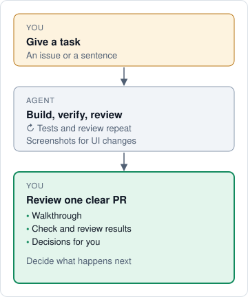

# Shaka

**Know what your AI coding agent really did before you merge it.**

Shaka is a free, open-source skill for Claude Code, Codex, Cursor, OpenCode, and Pi. A skill
is a set of instructions your coding agent loads. Give your agent a task with `/shaka`, and
it writes the code, tests it, has a second AI review it, and hands you a pull request that
shows what changed, what was proven, and where to look.

[Try it on a small fix](#get-started) ·
[Watch the 52-second demo](https://www.youtube.com/watch?v=T6Fstx2fGJI) ·
[Read a real Shaka PR](https://github.com/shakacode/shaka/pull/667) ·
[See the guides and more examples](https://shaka.shakacode.com/)



<a id="why-use-it"></a>

## The problem

Your agent writes code faster than you can check it, then tells you the work is done. So you
either read every line or merge and hope.

We built Shaka at [ShakaCode](https://www.shakacode.com), where we ship with coding agents every
day. In our own repository, its second AI caught
[102 defects across 147 PRs](https://shaka.shakacode.com/docs/articles/review-process-study)
before that code was pushed.

## What changes when you use it

- **You know where to look.** Each PR says why the change exists and which files you should
  read, if any.
- **You see proof, not promises.** Every check links to its result, and anything unproven is
  flagged. UI changes include before-and-after screenshots.
- **A second AI reviews the work first.** It never saw the chat that wrote the code, and its
  findings get fixed before anything is pushed.
- **You don't have to keep reminding it.** Say what you want once, and it tests, reviews, and
  explains its own work.
- **You stay in charge of merging.** By default, you merge. Even if you
  [let the agent merge](https://shaka.shakacode.com/docs/working-with-shaka#choose-a-merge-policy),
  large or risky changes still come back to you.
- **Less prompt-injection risk.** On public repositories, Shaka
  [ignores comments from untrusted authors](https://shaka.shakacode.com/docs/workflow#trust-model).

### Why not just ask my agent to test and review?

That helps, but Shaka does it the same way on every task, with a reviewer that didn't write the code.
When the agent merges, Shaka stops it if a required review is missing.
[See what code enforces](https://shaka.shakacode.com/docs/workflow#what-is-enforced).

## What it works with

| | |
| --- | --- |
| **Coding agents** | Claude Code, Codex, Cursor, OpenCode, and Pi ([details](https://shaka.shakacode.com/docs/coding-agents)) |
| **AI models** | Whatever your agent uses |
| **Code hosts** | GitHub and GitLab |
| **Second reviewer** | Claude, Codex, Grok, or DeepSeek if you have one set up, otherwise a fresh session of your own model |
| **Cost** | Free and open source ([MIT](LICENSE)). You pay only for your own AI usage, and each PR reports it. |

<a id="get-started"></a>
<a id="requirements"></a>
<a id="example-prompts"></a>

## Try it on a small fix

1. Paste this into your coding agent:

   ```text
   Install Shaka from https://github.com/shakacode/shaka.
   ```

   It installs into its own folder and changes none of your repositories. Prefer to install
   it manually? Follow the [manual installation guide](https://shaka.shakacode.com/docs/manual-installation).

2. Give it something small you can check:

   ```text
   /shaka Fix search when the query contains an apostrophe. Go.
   ```

   In Codex, use `$shaka`.

3. Read the PR, then merge it or close it. By default, nothing goes in until you merge.

New to pull requests? [Shaka in pictures](https://shaka.shakacode.com/docs/shaka-in-pictures)
walks you through a practice task.

## All you need to remember

| Say | What happens |
| --- | --- |
| `/shaka <task or issue link>` | Does the task and opens a PR. |
| `/shaka doctor` | Checks your setup. If it reports a problem, tell your agent to fix it. |
| `/shaka settings` | Explains this repository's settings. Ask it to change one. |
| Anything else | Ask your agent how to get Shaka to do it. |

You don't need to read the docs to use Shaka. Your agent reads them for you, and you can
[browse them](https://shaka.shakacode.com/) anytime.

[Contributing](CONTRIBUTING.md) · [MIT license](LICENSE)

## Names and logos

The MIT license covers the code and documentation. It does not grant rights to
use the Shaka or ShakaCode names or logos. ShakaCode is a registered trademark of
ShakaCode LLC in the United States. You may say that your work uses or is based on
Shaka. Give a fork or product its own name, so it does not appear to come from
ShakaCode.
